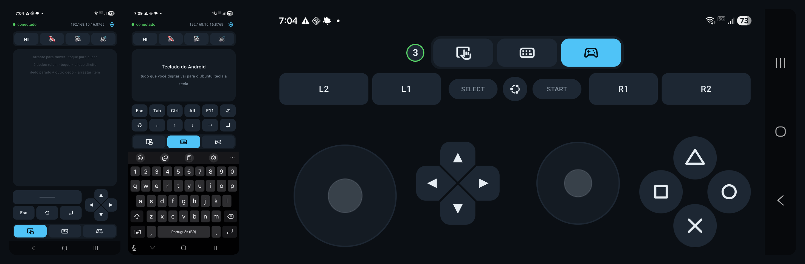
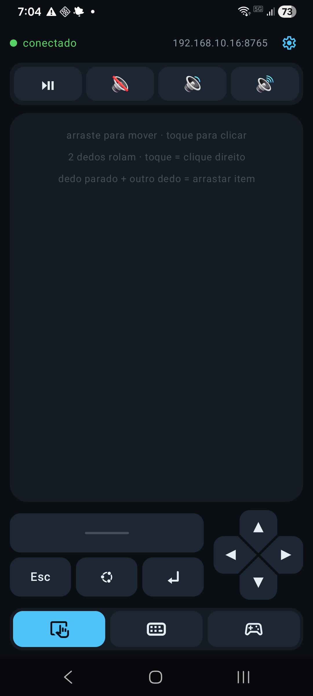
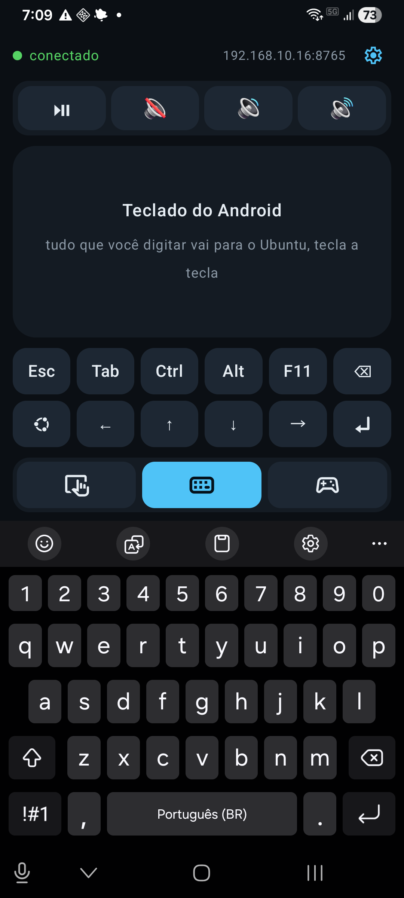
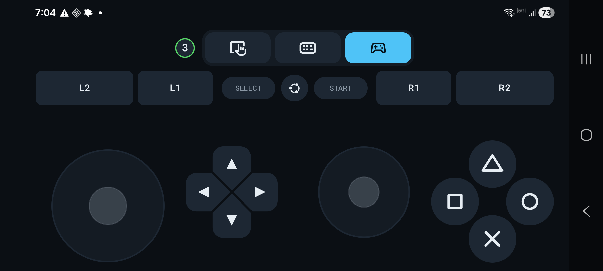
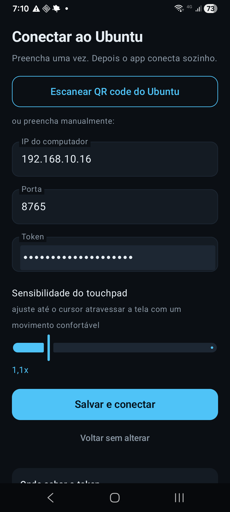

# Ubuntu Controller

**O celular como teclado, touchpad e gamepad de um Ubuntu ligado à TV — por Wi-Fi, sem dongle, sem Bluetooth e sem instalar driver no PC.**




---

## Por que existe

Meu computador fica ligado à TV da sala. Para usar de fato — abrir um vídeo, procurar
um arquivo, jogar — eu precisava de mouse e teclado no sofá, e nenhuma solução pronta
resolvia bem:

- **apps de controle por Bluetooth HID** esbarram no perfil limitado do Android: nada de
  gamepad, dificuldade com acentos e pareamento que se desfaz sozinho;
- **Remote Desktop** projeta a tela inteira: gasta banda, atrasa e pede confirmação de
  acesso a cada conexão;
- **teclados sem fio** resolvem metade do problema e somam mais um aparelho para carregar.

A ideia foi simples: o celular já está no bolso, já tem teclado, tela de toque e já está
na mesma rede Wi-Fi. Faltava só fazê-lo conversar com o PC.

## O que ele faz

| | |
|---|---|
| **Touchpad** | Arrastar move, toque clica, dois dedos rolam, toque com dois dedos é clique direito. **Arrastar item** é um dedo parado (a âncora) enquanto o outro desliza — dá para levar um arquivo em várias passadas sem soltar. |
| **Teclado** | O teclado do Android, tecla a tecla, direto no Ubuntu — com acentos, cedilha e símbolos do layout ABNT2. Ctrl e Alt ficam "grudados" para combos. |
| **Gamepad** | Um controle de PS5 de verdade: dois analógicos, direcional, botões de face, ombros e gatilhos. O jogo vê um controle na lista de dispositivos, não teclas disfarçadas. |
| **Mídia e volume** | Play/pause, mudo, abaixar e aumentar, sempre à mão. |
| **Pareamento por QR** | Aponta a câmera para a janela do Ubuntu e pronto. A configuração fica salva: nas próximas vezes o app abre e conecta sozinho. |
| **Dois jogadores** | Cada celular conectado ganha o **seu** gamepad virtual (até quatro), e o app mostra qual é o seu: 1, 2, 3… |
| **Dois idiomas** | Português e inglês, seguindo o idioma do sistema. |

## Telas

| Touchpad | Teclado |
|---|---|
|  |  |

| Gamepad | Configuração |
|---|---|
|  |  |

## Como funciona

```
   celular (Kotlin/Compose)                Ubuntu (Python)
  ┌───────────────────────┐   TCP/JSON   ┌──────────────────────────┐
  │ toque → comando       │ ───────────► │ agente escuta :8765      │
  │ uma linha JSON por    │              │ valida token             │
  │ comando               │ ◄─────────── │ responde "ola" + canal   │
  └───────────────────────┘              └───────────┬──────────────┘
                                                     │ /dev/uinput
                                          ┌──────────▼──────────────┐
                                          │ teclado, mouse e gamepad │
                                          │ virtuais (kernel)        │
                                          └──────────┬──────────────┘
                                                     ▼
                                             GNOME / jogos (Wayland)
```

O agente não usa `xdotool` nem o portal de Remote Desktop: ele cria **dispositivos de
entrada no kernel** via `/dev/uinput`. Para o sistema é hardware de verdade — funciona em
app nativo, em jogo e na tela de bloqueio, sem pedir permissão a cada sessão.

## Tecnologias

| Camada | O que usei | Por quê |
|---|---|---|
| App Android | **Kotlin 2.1 + Jetpack Compose** (Material 3), `minSdk 26` | UI declarativa para uma tela cheia de gestos; uma única biblioteca externa (`zxing-android-embedded`, para ler o QR) |
| Rede | **TCP + NDJSON** — uma linha JSON por comando | Sem HTTP, TLS ou framework do lado do celular: um socket e um `BufferedReader`. Menos APK, menos bateria |
| Agente | **Python 3.14 + asyncio** | Servidor TCP concorrente em ~400 linhas, sem dependência além de `python-evdev` |
| Injeção | **`/dev/uinput` com `python-evdev`** | Único caminho independente de compositor: X11, Wayland, jogos e tela de login |
| Acentuação | **libxkbcommon + tabelas Compose do X11** via `ctypes` | Gera um mapa `caractere → sequência de keycodes` a partir do layout real da máquina, em vez de adivinhar posições |
| App do Ubuntu | **GTK4 + libadwaita** (PyGObject) | Mesma linguagem visual do GNOME; janela com QR, status e início automático |
| Bandeja | **StatusNotifierItem + DBusMenu** por D-Bus | O `AyatanaAppIndicator3` é GTK3 e não carrega num processo GTK4 |
| Ícones | **SVG + PNG** no desktop, **vetores** no Android, **Material Symbols** nas abas | Cada plataforma no formato que ela desenha bem, inclusive em 16 px |
| i18n | **resources** no Android; dicionário + `LANG` no Ubuntu | Sem gettext: são poucas frases e o app é instalado como arquivos soltos |

## Estrutura do projeto

```
servidor/                  agente do lado Ubuntu (Python puro)
  agente.py                servidor TCP, autenticação e roteamento dos comandos
  injecao.py               teclado, mouse e gamepad virtuais via /dev/uinput
  teclas.py                teclas especiais e combos
  mapa_br.py               GERADO: caractere → sequência de keycodes (ABNT2)
  gerar_mapa.py            gera o mapa a partir do layout real (libxkbcommon + Compose)
  teste_protocolo.py       teste de fumaça (roda sem uinput)
  teste_gamepad.py         lê de volta do /dev/input o que o controle emitiu
  teste_sdl.py             confere o gamepad pelos olhos do SDL (precisa de pygame)
  teste_dois_controles.py  dois celulares, dois gamepads, sem interferência
android/                   app nativo Kotlin + Jetpack Compose
app/                       app de bandeja do Ubuntu (GTK4 + libadwaita) e ícones
docs/                      capturas e o mapa do gamepad
udev/                      regra que libera /dev/uinput para a sessão
```

## Como usar

**[⬇ Baixar o APK (1.0.0)](https://github.com/tiagosantos1988/ubuntu-controller/releases/latest)** — assinado com a chave de release.

### Requisitos

- **Ubuntu** com GNOME (testado no 26.04 e no GNOME 50, sessão Wayland) e Python 3.10+;
- **Android 8.0+** (`minSdk 26`) para o app;
- para compilar o app: JDK 17 — o Gradle vem pelo wrapper (`./gradlew`).

### 1. No Ubuntu (uma vez)

```bash
sudo ./liberar-uinput.sh     # regra udev que dá acesso ao /dev/uinput
./instalar-app.sh            # app na bandeja + início automático
```

O primeiro pede sua senha; o segundo não. Depois disso o agente sobe junto com a sessão e
o ícone aparece na barra superior. Para conferir se liberou:

```bash
test -w /dev/uinput && echo liberado
```

O app do Ubuntu fica em segundo plano, com **instância única** (abrir pelo menu só traz a
janela para frente). Fechar a janela não encerra: volta para a bandeja — para sair de vez,
use *Sair* no menu do ícone.

### 2. No celular

Baixe o APK da **[última release](https://github.com/tiagosantos1988/ubuntu-controller/releases/latest)**
— ou compile: `cd android && ./gradlew assembleRelease` (o APK sai em
`android/app/build/outputs/apk/release/`, e a assinatura vem de `android/keystore.properties`,
que não é versionado). Instale no celular (o sistema pede para permitir "fontes
desconhecidas") e abra. Na primeira vez, aponte a câmera para o
**QR code** da janela do Ubuntu — ou digite IP, porta e token à mão.

O QR carrega `CR1|ip|porta|token`, um formato curto de propósito: 37 módulos, mais fácil
de ler a distância que um código com o dobro de informação.

O token é o que protege a máquina: sem ele ninguém injeta nada. Fica em
`~/.config/controle-remoto/token` (permissão `0600`) e pode ser trocado apagando o arquivo
e reiniciando o app.

> **Dica:** configure IP fixo, ou reserva de DHCP no roteador, para o computador. Se o
> endereço mudar, o app deixa de encontrar o agente até você ajustar a configuração na
> engrenagem do topo.

## Uso

**Touchpad.** Arraste para mover, toque para clique esquerdo, dois dedos rolam, toque curto
com dois dedos é clique direito. A área de texto do modo teclado funciona como mini
touchpad, com os mesmos gestos (é o mesmo modificador, então os dois não podem divergir).

**Arrastar item** (mover arquivo, redimensionar janela, selecionar texto): **um dedo
parado + outro dedo andando**. O dedo parado é a âncora e segura o botão esquerdo enquanto
estiver na tela; o outro dedo move o ponteiro. E **só a âncora solta** — dá para arrastar
por distâncias maiores que o touchpad, dando várias passadas sem soltar o item.

**Teclado.** Cada tecla vai para o Ubuntu na hora (nada de digitar e apertar enviar). Ctrl
e Alt ficam "grudados": toque para armar e a próxima tecla sai em combo. O eco do texto
enviado some sozinho depois de 10 s sem digitar, ao apertar Enter ou ao usar a área como
touchpad — e limpar o eco não apaga nada no PC.

**Joystick.** O celular deitado vira um controle de PS5: `L2 · L1` e `R1 · R2` na faixa de
cima, `SELECT · PS · START` no meio, analógico esquerdo e `△ ○ ✕ □` embaixo nos cantos
(onde os polegares caem) e direcional e analógico direito mais acima e puxados para o
centro. As abas ficam no alto justamente para o polegar não trocar de modo sem querer no
meio do jogo. Tocar o miolo de um analógico sem arrastar dispara **L3/R3**.

Todos os botões têm o mesmo retorno: som, vibração e destaque de 110 ms.

## O gamepad

O mapa completo de botões e eixos — nome no app, código do kernel, índice no SDL, Godot e
Unity — está em **[`docs/GAMEPAD.md`](docs/GAMEPAD.md)**. É o documento para levar a uma
conversa de desenvolvimento de jogo.

Resumo: o app cria um gamepad virtual por celular (`Controle Remoto Gamepad`, `… 2`,
`… 3`, `… 4`), com 6 eixos, 13 botões e um direcional. Os analógicos saem com zona morta
já aplicada e os gatilhos são digitais (0 ou 255).

Cada celular tem o **seu** controle — é o que permite co-op local de verdade. Teclado e
ponteiro continuam únicos e compartilhados, porque para o PC são um teclado só. Ao lado
das abas, um selo mostra qual controle é este celular; o aro do selo é o estado da conexão
(verde conectado, azul conectando, vermelho erro).

Cuidados que valem para o jogo: o controle é criado quando o celular **autentica** (abra o
jogo depois), cada desconexão solta **só o próprio** controle, e quando o último celular
sai os controles extras são encerrados.

## Engenharia: os problemas que custaram tempo

**1. Wayland não aceita `xdotool`.**
O XTEST só alcança janelas X11, via Xwayland. Criar um dispositivo `uinput` resolve de uma
vez: o kernel o entrega ao compositor como hardware, e vale também para jogos e para a
tela de bloqueio.

**2. Acentos saíam embaralhados (`ação` virava `ãçao`).**
O IBus compõe teclas mortas de forma **assíncrona**: se a letra base chega junto com o
acento, ele se perde. Medido nesta máquina: 0 ms falha, 5 ms já funciona. O agente espera
**15 ms** entre a tecla morta e a base — imperceptível ao digitar, e a pausa só existe em
caracteres acentuados.

**3. Apagar parava de funcionar com o campo vazio.**
O teclado do Android só entrega evento de backspace quando há texto no campo. A solução é
um **espaço de preenchimento no início** do campo (invisível), que o backspace consome — e
que fica no início, não no fim, para o app nunca reescrever o texto por baixo do IME, o
que dessincronizava o teclado do Samsung e gerava um backspace fantasma por caractere.

**4. Duplo toque não arrasta item.**
Num touchpad de notebook quem adia a decisão do duplo clique é o `libinput`, olhando o
deslocamento. Aqui os eventos vão crus para o sistema, que conta o segundo clique como
"abrir" no instante do pressionar. Daí o gesto ser outro: **um dedo parado segura o botão,
o outro dedo move o ponteiro** — e só a âncora solta.

**5. Um gamepad virtual tem regras próprias.**
Sem declarar a faixa dos eixos (`absinfo`), o analógico nasce em 0..255 e vira um botão de
três posições. A tupla do `python-evdev` é `(código, valor, mínimo, máximo, fuzz, flat,
resolução)` — com mínimo e máximo trocados o kernel responde apenas `EINVAL`, sem dizer o
motivo. E o SDL, ao reconhecer o dispositivo, usa a ordem de botões dele: **△ chega como
`X` e □ como `Y`** (documentado, com a correção, no `GAMEPAD.md`).

**6. Bandeja em GTK4 não tem AppIndicator.**
O `AyatanaAppIndicator3` é GTK3 e não pode ser carregado no mesmo processo. O item de
bandeja é registrado direto por D-Bus (`StatusNotifierItem` + `DBusMenu`) — e hífen não é
válido em caminho de objeto D-Bus, daí `…/controle_remoto`.

## Protocolo

TCP, uma linha JSON por mensagem. A primeira linha autentica; depois, cada linha é um
comando.

```json
{"t": "auth", "token": "<token>"}
```

| comando | exemplo |
|---|---|
| movimento relativo | `{"t":"mover","dx":12,"dy":-4}` |
| rolagem | `{"t":"rolar","dy":3}` |
| clique / botão | `{"t":"clique","b":"left"}` · `{"t":"botao","b":"right","down":true}` |
| tecla | `{"t":"tecla","k":"ESC"}` · `{"t":"tecla","k":"ALT","acao":"down"}` |
| combo | `{"t":"combo","keys":["ALT","TAB"]}` |
| texto (com acentos) | `{"t":"texto","s":"ação"}` |
| apagar | `{"t":"backspace","n":2}` |
| gamepad — botão | `{"t":"pad","b":"cross","down":true}` |
| gamepad — eixos | `{"t":"eixo","e":"l","x":0,"y":-32767}` |
| gamepad — soltar tudo | `{"t":"pad_reset"}` |
| ping | `{"t":"ping"}` → `{"t":"pong"}` |

Botões: `cross`, `circle`, `triangle`, `square`, `l1`, `r1`, `l2`, `r2`, `select`,
`start`, `ps`, `l3`, `r3`. Grupos de eixo: `l` e `r` (−32768..32767) e `h` (direcional,
−1..1). Limites no servidor: 400 px por movimento, 512 caracteres por texto, nomes
validados contra a tabela.

Ao conectar, o agente responde `{"t":"ola","versao":1,"porta":8765,"controle":N}` — o `N`
é o número do gamepad deste celular.

## Testes

Sem celular e sem `/dev/uinput`, com o agente em modo simulado:

```bash
cd servidor
python3 agente.py --simular --porta 8799 &
python3 teste_protocolo.py --porta 8799     # autenticação, comandos, limites e erros
```

Para conferir o gamepad de verdade, sem jogo:

```bash
python3 teste_gamepad.py        # lê de volta do /dev/input o que o controle emitiu
python3 teste_sdl.py            # o que o SDL vê: nome, eixos, botões (precisa de pygame)
python3 teste_dois_controles.py # dois celulares, dois controles, sem interferência
```

## Limitações

- **É para a rede local.** Não há TLS: quem tiver o token na mesma rede controla a máquina
  como se fosse o teclado físico. **Não exponha a porta 8765 na internet.**
- **Sem force feedback**: o dispositivo virtual não expõe `EV_FF`.
- **O botão PS pode ser capturado** pelo Steam ou pelo GNOME antes de chegar ao jogo.
- **Abra o jogo depois de conectar os celulares**: controle que aparece com o jogo já
  rodando normalmente não é enumerado.

## Problemas comuns

- **Não conecta** — IP mudou, agente parado, ou o roteador tem isolamento de clientes
  (AP isolation). O log do agente fica em `~/.local/state/controle-remoto/agente.log`.
- **"os 4 controles estão em uso"** — os quatro gamepads virtuais têm dono. O app tenta de
  novo a cada 3 s e entra sozinho quando uma vaga abre; se demorar, veja quem está
  conectado no log do agente. Um celular que sai da rede sem se despedir (app fechado à
  força, fora do alcance do Wi-Fi) libera a vaga em ~85 s pelo *keepalive* do TCP — antes
  o controle ficava preso para sempre.
- **Conecta mas nada acontece** — falta a regra udev, ou falta logout/login para a ACL
  valer. Confira com `test -w /dev/uinput`.
- **Cursor lento ou rápido demais** — sensibilidade na engrenagem do topo.
- **Acentos errados** — regenerar o mapa se o layout do sistema mudou:
  `cd servidor && python3 gerar_mapa.py` (ou `--layout us`).
- **Tecla de mídia não responde** — o GNOME usa o player ativo (MPRIS); sem nada tocando,
  play/pause não tem efeito.
- **Botão travado no jogo** — saia da aba (o app manda `pad_reset`) ou reinicie o agente;
  ele solta tudo ao desconectar.

## Licença e créditos

Código sob **[MIT](LICENSE)** — use, modifique, publique, só mantenha o aviso de copyright.

Feito por **Tiago Santos** · [github.com/tiagosantos1988](https://github.com/tiagosantos1988)

- Ícones das abas: **[Material Symbols](https://fonts.google.com/icons)** (Apache 2.0),
  com o crédito nos próprios arquivos vetoriais.
- Símbolo do Ubuntu: marca da Canonical, usado aqui em projeto pessoal e sem fins
  comerciais.
- Som e vibração: o clique é sintetizado (`res/raw/clique.wav`), sem amostra de terceiros.
